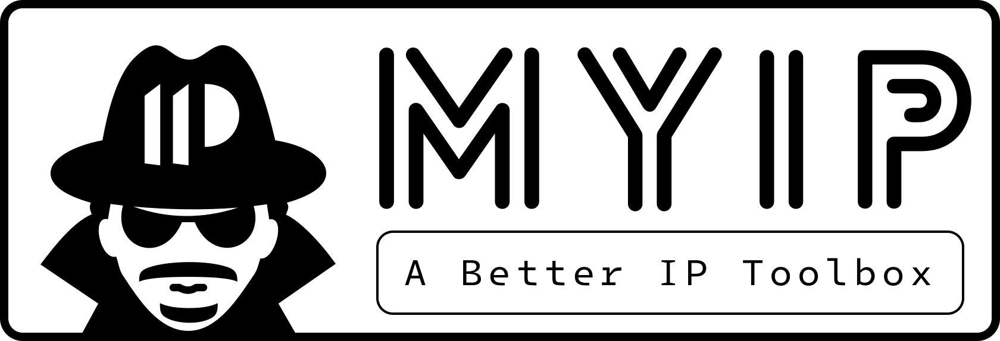

# 🧰 MyIP - Una caja de herramientas de IP mejorada

> [!NOTE]
> Esta es una traducción mantenida por la comunidad; el README en inglés es la fuente canónica y esta versión puede quedar desactualizada.

<div align="center">



<a href="https://trendshift.io/repositories/5332" target="_blank"></a>

[](https://github.com/awesome-selfhosted/awesome-selfhosted)


[](https://ipcheck.ing)


[](https://github.com/jason5ng32/MyIP/actions/workflows/ci.yml)

[English](README.md) | [简体中文](README_ZH.md) | [繁體中文](README_ZH-TW.md) | [Русский](README_RU.md) | [Français](README_FR.md) | [Português (BR)](README_PT-BR.md) | [Shqip](README_SQ.md) | [ไทย](README_TH.md) | [हिन्दी](README_HI.md) | [Türkçe](README_TR.md) | [Español](README_ES.md)

Una caja de herramientas de IP integral y de código abierto: consulta de IP desde múltiples fuentes, pruebas de conectividad, detección de fugas de WebRTC y DNS, test de velocidad, MTR, comprobación de censura, Whois y mucho más — alójala tú mismo con un solo comando de Docker.

👉 Demo: [https://ipcheck.ing](https://ipcheck.ing)

No dudes en guardar la demo en favoritos o en desplegar la tuya propia.

[](https://hub.docker.com/r/jason5ng32/myip)

</div>

## 👀 Funciones

### 🪪 Tu IP y tu identidad

* 🛜 **Tarjetas de IP**: Detecta tu IPv4 e IPv6 desde múltiples fuentes independientes, una junto a otra — país, región, ciudad, ASN, organización y la zona horaria local de la IP.
* 🔍 **Consultar IP**: Obtiene esa misma información detallada para cualquier dirección IP que te despierte curiosidad.
* 📸 **Historial de instantáneas**: Cada vez que se abre la página principal, guarda los resultados de sus pruebas — información de IP, conectividad, WebRTC, prueba de fuga de DNS, test de velocidad — como una instantánea. Compara dos cualesquiera y lee las diferencias línea por línea, como un diff de código; pon nombre o fija las que te importen — se guardan solo en tu navegador.
* 🖥️ **Huella del navegador**: Calcula la huella de tu navegador de varias formas y muestra qué es lo que te hace identificable.

### 🕵️ Fugas y privacidad

* 🚥 **Detección de WebRTC**: Revela la dirección IP expuesta durante las conexiones WebRTC, incluido si el endurecimiento de privacidad de tu navegador está activado.
* 🛑 **Prueba de fuga de DNS**: Muestra qué puntos de salida DNS resuelven tus consultas, para evaluar el riesgo de fugas de DNS al usar VPN o proxies.
* 🛡️ **Prueba de bloqueo de anuncios y rastreadores**: Comprueba qué bloquea realmente tu bloqueador de anuncios, navegador, filtro DNS, VPN o router — redes publicitarias, analítica, rastreadores sociales, monitorización de errores, telemetría de fabricantes de dispositivos, scripts de seguimiento y ocultación de elementos.
* 📋 **Lista de comprobación de seguridad**: Una lista de 258 puntos de ciberseguridad personal repartidos en 12 áreas, con el progreso guardado en tu navegador.

### 📡 Pruebas de red

* 🚦 **Comprobación de conectividad**: Prueba la accesibilidad de hasta 60 sitios de tu elección, con resultados de latencia mínima en varias rondas, además de listas de importación seleccionadas: desde paquetes por país hasta IA, redes sociales, streaming, gaming, desarrollo y más. A partir de los resultados, indica si el acceso a internet global es actualmente viable para ti.
* 🚀 **Test de velocidad**: Mide tu descarga, tu subida y tu latencia contra redes de borde.
* ⏱️ **Prueba de latencia global**: Hace ping a tu objetivo desde sondas de todo el mundo — elige países entre todas las sondas Globalping disponibles, agrupadas por continente.
* 🚉 **Prueba MTR**: Ejecuta MTR desde sondas distribuidas por todo el mundo para ver la ruta que siguen realmente los paquetes.
* 🚧 **Comprobación de censura**: Muestra dónde está bloqueado un sitio web en el mundo y por qué medios.
* 🚏 **Prueba de reglas de proxy**: Verifica que la configuración de reglas de tu software de proxy funciona tal como pretendías.

### 🔦 Consultas e infraestructura

* 📟 **Resolutor DNS**: Resuelve un dominio a través de varios resolutores a la vez, agrupados por país — una forma sencilla de detectar secuestro o contaminación.
* 📓 **Búsqueda Whois**: Realiza consultas Whois de nombres de dominio, direcciones IP y números de AS.
* 🗄️ **Consulta de MAC**: Identifica el fabricante y los detalles que hay detrás de una dirección física.
* 🧮 **Calculadora de IP**: Aritmética de subredes, conversiones de notación y detalles de interfaces IPv6 para cualquier IP, prefijo, rango o lista, calculados localmente.
* 🧾 **Consulta masiva de IP**: Pega listas de IP o registros de servidor en bruto (Nginx, Apache, firewall, CDN…) para geolocalizar todas sus IP a la vez.
* 🛰️ **Información de ASN y topología ascendente**: Justo en cada tarjeta de IP — detalles del AS, anuncios históricos del prefijo de la IP y las rutas ascendentes desde su ASN hasta la red troncal de Nivel 1.
* 🛂 **Perfil de ASN**: La imagen completa de cualquier AS: el registro con el registro Whois en bruto, su rango y tamaño global, la calidad de su tráfico y sus conexiones, dónde se usa su espacio IPv4, cada prefijo anunciado con su estado RPKI, sus ascendentes, pares y clientes, y los intercambios de internet y centros de datos donde está presente.
* 📶 **Estado de los servicios**: Disponibilidad en vivo de servicios conocidos — Claude, OpenAI, GitHub, Cloudflare y más — desde sus páginas de estado oficiales, con los incidentes recientes.

### ✨ Plataforma

* 📤 **Informes compartibles**: Convierte los resultados de tus pruebas en un informe de diagnóstico: un enlace de solo lectura con caducidad automática, Markdown listo para IA o JSON.
* ⌨️ **API de curl**: Obtén tu IP desde la terminal con un solo comando `curl`.
* 🌍 **Earth Online**: Un panel que emite los eventos de caídas de internet globales a medida que ocurren.
* 🌗 **Modo oscuro**: Sigue tu sistema automáticamente, con un interruptor manual.
* 📲 **PWA**: Instalable como aplicación en tu teléfono y como aplicación de Chrome en tu escritorio.
* ⚡ **Atajos de teclado**: Cada función tiene el suyo — pulsa `?` para ver la lista.
* 🔤 **Varios idiomas**: La interfaz viene en 6 idiomas, y añadir el tuyo solo requiere un paquete de idioma.

## 📕 Cómo usarlo

### Con Docker

Un solo comando y listo:

```bash
docker run -d -p 18966:18966 --name myip --restart always jason5ng32/myip:latest
```

O haz clic en el botón «Deploy with Docker» que hay en la parte superior de esta página.

### Despliegue en un entorno Node

Asegúrate de tener Node.js instalado y luego clona el código:

```bash
git clone https://github.com/jason5ng32/MyIP.git
```

Instala y compila. Este proyecto usa pnpm — si no lo tienes, instálalo primero (npm viene con Node, así que este comando siempre funciona):

```bash
npm install -g pnpm
pnpm install && pnpm run build
```

Ejecuta:

```bash
pnpm start
```

El programa se ejecutará en el puerto 18966.

## ⚙️ Configuración

> [!IMPORTANT]
> **Se requieren credenciales de MaxMind GeoLite2.** Son las que alimentan la geolocalización de IP y las consultas de ASN — sin ellas, la fuente de MaxMind devuelve 503. Son gratuitas: → [Configuración de MaxMind](https://docs.ipcheck.ing/developer/getting-started/maxmind-setup)

> [!WARNING]
> **`ALLOWED_DOMAINS` es obligatorio en un dominio real.** Es la lista de nombres de host permitidos para la API del backend — sin ella, toda petición procedente de un dominio que no sea localhost recibe un 403. → [Proxy inverso y dominios](https://docs.ipcheck.ing/developer/getting-started/reverse-proxy-and-domains)

```bash
docker run -d -p 18966:18966 \
  -e MAXMIND_ACCOUNT_ID="YOUR_ACCOUNT_ID" \
  -e MAXMIND_LICENSE_KEY="YOUR_LICENSE_KEY" \
  -e DATASET_AUTO_UPDATE="true" \
  -e ALLOWED_DOMAINS="your-domain.com" \
  --name myip --restart always \
  jason5ng32/myip:latest
```

Todo lo demás — claves de API opcionales, seguridad y limitación de tasa, registro, Sentry, los dominios de la API de curl — está documentado en la [referencia de variables de entorno](https://docs.ipcheck.ing/developer/reference/environment-variables).

## 📖 Documentación

Las guías completas están en el Centro de Documentación de MyIP: **[docs.ipcheck.ing](https://docs.ipcheck.ing)**

* [Guía para desarrolladores](https://docs.ipcheck.ing/developer) — despliegue, configuración, arquitectura y contribución
* [Base de conocimiento](https://docs.ipcheck.ing/knowledge-base) — cómo usar cada herramienta, diagnóstico de red paso a paso y conceptos de redes

## 🤝 Contribuir

¡Las contribuciones son bienvenidas! Mantenemos un conjunto seleccionado de tareas para principiantes — cada una con las rutas de archivo exactas, los criterios de aceptación y las pruebas que te guían hasta una compilación en verde:

* 🏷️ [Buenas primeras issues](https://github.com/jason5ng32/MyIP/labels/good%20first%20issue) — añade un resolutor DNS de tu país, añade listas de sitios seleccionadas, traduce el README a tu idioma, mejora las traducciones y más
* 🌐 [TRANSLATING.md](TRANSLATING.md) — lleva la interfaz a tu idioma: un paquete de idioma y una línea en el registro, y **una traducción parcial es una primera PR bienvenida**
* 📄 [CONTRIBUTING.md](CONTRIBUTING.md) — configuración, convenciones y cómo fluyen las PR (dirigidas a la rama `dev`)

## 👩🏻‍💻 Uso avanzado

<details>
<summary>Reglas de proxy para comprobar tu IP real y la IP de tu proxy al mismo tiempo</summary>

Si usas un proxy para acceder a internet, plantéate añadir esta regla a la configuración de tu proxy (modifícala según tu cliente). Esta configuración te permite comprobar tanto tu IP real como la IP que tienes cuando usas el proxy:

```ini
# IP Testing
IP-CIDR,1.0.0.2/32,Proxy,no-resolve
IP-CIDR6,2606:4700:4700::1111/128,Proxy,no-resolve
DOMAIN,4.ipcheck.ing,DIRECT
DOMAIN,6.ipcheck.ing,DIRECT
# Rule Testing
DOMAIN,ptest-1.ipcheck.ing,Proxy1
DOMAIN,ptest-2.ipcheck.ing,Proxy2
DOMAIN,ptest-3.ipcheck.ing,Proxy3
DOMAIN,ptest-4.ipcheck.ing,Proxy4
DOMAIN,ptest-5.ipcheck.ing,Proxy5
DOMAIN,ptest-6.ipcheck.ing,Proxy6
DOMAIN,ptest-7.ipcheck.ing,Proxy7
DOMAIN,ptest-8.ipcheck.ing,Proxy8
DOMAIN,ptest-9.ipcheck.ing,Proxy9
DOMAIN,ptest-10.ipcheck.ing,Proxy10
DOMAIN,ptest-11.ipcheck.ing,Proxy11
DOMAIN,ptest-12.ipcheck.ing,Proxy12
```

</details>

## 💖 Patrocinadores y colaboradores

Como proyecto de código abierto, estoy muy agradecido a los siguientes patrocinadores por su apoyo:

**Patrocinadores**

<a href="https://proxy-seller.com/?partner=4FEC1644D12240F4"></a><br />
<sub>↳ **<a href="https://proxy-seller.com/?partner=4FEC1644D12240F4">Proxy-Seller</a>** — ofrece proxies IPv4/IPv6 privados residenciales, móviles (4G/5G/LTE), de ISP y de centro de datos con soporte HTTP(S) y SOCKS5, más de 47M de IP residenciales en más de 220 ubicaciones, segmentación precisa por país/ciudad/ISP, un 99,7 % de tiempo de actividad y soporte 24/7. Los usuarios de MyIP pueden usar el código promocional `CHECKINGIP15` para obtener un 15 % de descuento.
</sub>

<a href="https://v.ps/?utm_source=ipcheck.ing&utm_medium=referral&utm_campaign=github_readme&utm_content=en"></a><br />
<sub>↳ **<a href="https://v.ps/?utm_source=ipcheck.ing&utm_medium=referral&utm_campaign=github_readme&utm_content=en">V.PS</a>** — VPS KVM de alto rendimiento con ubicaciones globales, conexión rápida e IPv4 e IPv6 incluidos.</sub>

----

**Colaboradores**

<p><a href="https://www.cloudflare.com/lp/project-alexandria/"></a></p>
<p><a href="https://www.1password.com"></a></p>
<p><a href="https://www.greptile.com/"></a></p>
<p><a href="https://www.sentry.io"></a></p>
<p><a href="https://www.gitbook.com"></a></p>

¿Te interesa patrocinar MyIP? [Conviértete en patrocinador](https://github.com/sponsors/jason5ng32)

## 📄 Licencia

[AGPL-3.0](LICENSE) © Jason Ng

