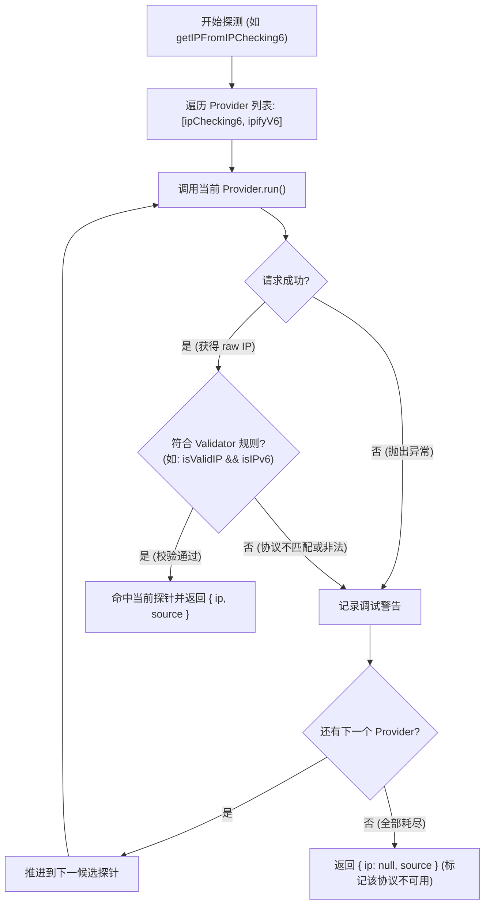

# 工具 01：IP 查询与双栈探测链架构

本教程详细解析 MyIP 的核心功能——**多源 IP 探针链（Probe Chain）与双栈协议严格隔离机制**。

---

## 1. 核心背景与挑战

在公共网络与代理环境下获取客户端真实公网 IP 面临诸多挑战：
1. **单点失效风险**：任何单一公共 IP 查询 API（如 ipify、Cloudflare、ip.sb）都可能因网络抖动、被阻断或限流而宕机。
2. **代理环境干扰**：当用户开启分流规则或代理工具时，不同域名的出口可能不同（例如某些域名走直接连接，某些域名走代理节点）。
3. **双栈混淆（IPv4 与 IPv6 错配）**：
   - 如果一个专属 IPv6 探测端点（如 `6.ipcheck.ing`）在客户端通过双栈代理节点解析时，可能返回该代理节点的 IPv4 地址。
   - 若系统仅校验“是否是合法 IP”，就会将 IPv4 错误填入 IPv6 显示卡片中，产生严重视觉混淆。

---

## 2. 探针链架构设计

MyIP 采用了**职责分离的高可用探针链模型**：
- **Provider（提供者）**：仅负责向单一接口发起请求并抽取原始 IP 字符串（或抛出异常），不进行业务判定。
- **Chain Runner（链条调度器）**：负责轮询 Provider、超时重试、**协议严格校验（Validator）**以及 Fallback 降级。

### 执行流程图



---

## 3. 关键机制：协议严格校验（Protocol Isolation）

为了杜绝 IPv4 穿透到 IPv6 卡片中，校验函数分为三类：

```javascript
// 基础校验（格式必须是合法的 IPv4 或 IPv6）
export const isValidIP = (ip) => /* 正则与八组分组校验 */;

// 纯 IPv4 校验器（排除含 ':' 的 IPv6）
export const isIPv4 = (ip) => isValidIP(ip) && !isIPv6(ip);

// 纯 IPv6 校验器（必须含 ':' 且符合 IPv6 规范）
export const isIPv6Only = (ip) => isValidIP(ip) && isIPv6(ip);
```

### 探针配置矩阵

| 探测卡片 | 候选探针列表 | 绑定的校验器 | 行为说明 |
| :--- | :--- | :--- | :--- |
| **IPCheck.ing IPv4** | `[ipChecking4, cloudflareV4, ipifyV4, myExternalIPV4]` | `isIPv4` | 严禁接收 IPv6 |
| **IPCheck.ing IPv6** | `[ipChecking6, ipifyV6]` | `isIPv6Only` | 严禁接收 IPv4；非 IPv6 自动跳过 |
| **Cloudflare IPv4** | `[cloudflareV4, myExternalIPV4]` | `isIPv4` | 专属 IPv4 节点 |
| **Cloudflare IPv6** | `[cloudflareV6, myExternalIPV6]` | `isIPv6Only` | 专属 IPv6 直连节点 |
| **双栈综合探针** | `[ipChecking64]` | `isValidIP` | IPv4 / IPv6 均可正常展示 |

---

## 4. 独立示例代码运行

我们把上述完整的多源调度链与协议隔离逻辑剥离为完全独立的单文件脚本 [`demo.js`](./demo.js)。

### 运行方式
无需安装任何依赖，仅需本地安装有 Node.js（v18+）：

```bash
node tutorials/01-ip-lookup/demo.js
```

### 预期输出示例
```text
=== 开始执行多源 IP 探针链演示 ===

[1] 正在探测 IPv4 (绑定校验器: isIPv4)...
    ✓ 探针 IPCheck.ing IPv4 响应成功: 146.235.217.200
  --> 最终解析结果: 146.235.217.200 (来源: IPCheck.ing IPv4)

[2] 正在探测 IPv6 (绑定校验器: isIPv6Only)...
  --> 最终解析结果: 240e:xxx:xxx (来源: IPCheck.ing IPv6 或 IPify IPv6)
  （若本地网络无 IPv6，将如实提示 null，绝不冒充展示 IPv4）
```
