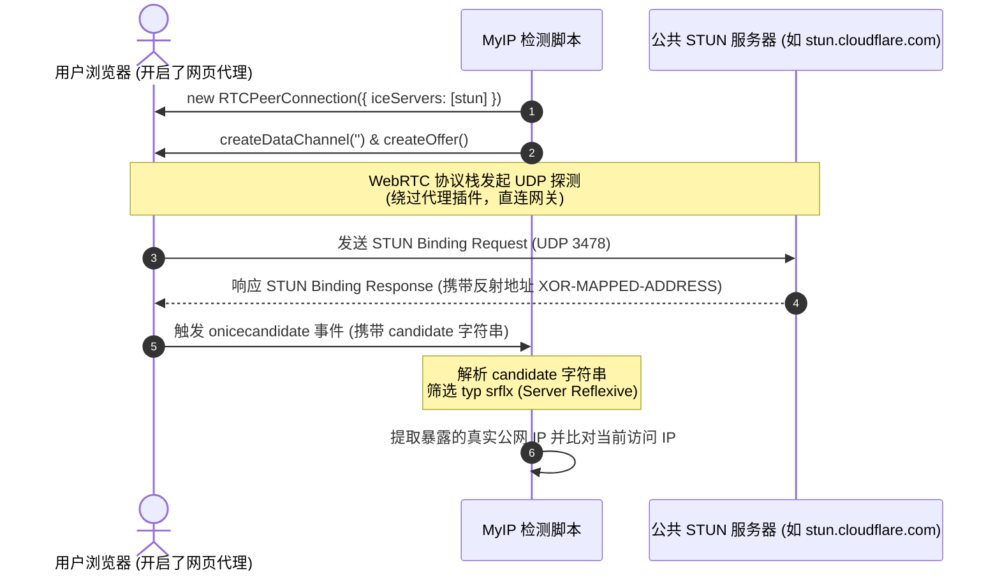

# 工具 02：WebRTC 真实 IP 泄漏检测原理与实现

本教程详细解析 MyIP 中 **WebRTC（Web Real-Time Communication）隐私泄漏检测** 的底层机制、攻击与防御场景及隔离实现。

---

## 1. 什么是 WebRTC 泄漏？

WebRTC 是一项支持网页浏览器进行实时音视频通话和 P2P 数据传输的开放技术。

为了让两个处于不同路由器（NAT）后的浏览器建立端到端直连，WebRTC 必须穿透 NAT，这就引入了 **ICE（Interactive Connectivity Establishment）** 框架和 **STUN（Session Traversal Utilities for NAT）** 协议。

### 泄漏的本质原因
当用户使用浏览器插件型代理（如普通 HTTP/Socks5 代理插件）时：
- 普通的 HTTP/HTTPS 请求会被代理插件拦截并转发到代理服务器；
- **但浏览器的 WebRTC 协议栈工作在底层的传输层（UDP/TCP）**，其向 STUN 服务器发起打洞探测时，请求会**绕过浏览器代理插件，直接经由本地真实网卡向外发送 UDP 数据包**！
- STUN 服务器看到的是客户端网卡的真实公网 IP，并将该 IP 写入 `ICE Candidate` 返回给网页；
- 恶意网页或第三方追踪脚本通过执行一段简单的 JavaScript，就能**瞬间拿到用户的真实家庭宽带 IP**，使得代理隐身完全失效。

---

## 2. WebRTC 穿透与检测工作流程



---

## 3. ICE Candidate 候选地址类型解析

在 `RTCPeerConnection.onicecandidate` 返回的 SDP 候选行中，格式通常如下：
```text
candidate:842163049 1 udp 1686052607 120.245.88.99 54321 typ srflx raddr 192.168.1.100 rport 54321 ...
```

字段剖析：
- `120.245.88.99`: STUN 服务器观察到的客户端反射 IP（这就是被泄漏的真实 IP）。
- `typ srflx`: 候选地址类型为 **Server Reflexive**（经由 STUN 反射而来）。
- `raddr 192.168.1.100`: 客户端局域网私有 IP（Host 地址）。

### 候选地址分类对照表

| 类型代码 | 全称 | 说明 | 隐私敏感度 |
| :--- | :--- | :--- | :--- |
| `host` | Host Candidate | 本机局域网 IP（现代浏览器默认使用 mDNS 生成随机 `.local` 字符串掩盖） | 低 |
| **`srflx`** | **Server Reflexive** | **通过 STUN 服务器反射出的真实公网 IP** | **极高（主要泄漏源）** |
| `prflx` | Peer Reflexive | 对等端反射 IP（连接过程中发现） | 高 |
| `relay` | Relayed Candidate | 通过 TURN 中继服务器转发的 IP | 低（仅暴露中继服务器 IP） |

---

## 4. 如何防范 WebRTC 泄漏？

1. **操作系统全局代理 / TUN 模式**：
   使用虚拟网卡（TUN/TAP 模式）接管整机所有网络流量，强制 UDP STUN 探测也必须经由代理节点出站。
2. **浏览器隐私配置**：
   - Chrome / Edge：安装诸如 *WebRTC Control* 扩展，或开启“禁止使用任何非代理 UDP”。
   - Firefox：在 `about:config` 中将 `media.peerconnection.enabled` 设置为 `false`。
   - Brave 浏览器：内置 WebRTC 防护模式（Shields 设置为 Disable non-proxied UDP）。

---

## 5. 独立示例运行

本教程提供两个完全解耦的实现：

### 1. 独立浏览器端交互 Demo：[`demo.html`](./demo.html)
由于 WebRTC 属于浏览器独有 API，直接使用任意浏览器双击打开本目录下的 `demo.html`：
- 实时可视化展示 RTCPeerConnection 建立过程；
- 打印 SDP Offer 与逐条 ICE Candidate 报文；
- 自动提取并高亮标注检测出的公网反射 IP 与 NAT 行为。

### 2. 独立解析算法验证脚本：[`demo.js`](./demo.js)
在命令行中验证生产级 ICE Candidate 报文解析与清洗算法：
```bash
node tutorials/02-webrtc-leak/demo.js
```
