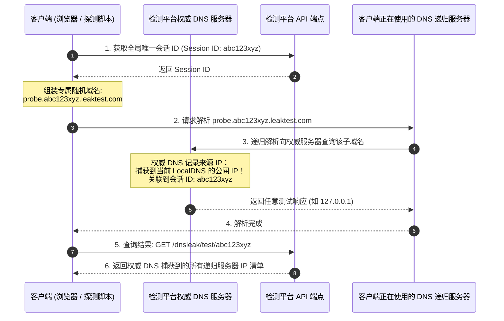

# 工具 03：DNS 泄漏检测原理与深度实现

本教程详细解析 MyIP 中 **DNS 泄漏检测（DNS Leak Test）** 的技术原理、探测模型及防范手段。

---

## 1. 什么是 DNS 泄漏？

**DNS 泄漏（DNS Leak）** 是指在开启 VPN、代理或加密通道的情况下，浏览器的常规网络访问虽然流经了代理通道，但**域名的 DNS 解析请求依然由本地运营商（ISP）的 DNS 服务器处理**。

### 为什么会产生致命安全隐患？
1. **真实 ISP 暴露**：如果您的代理节点在美国，但 DNS 解析服务器始终是“中国电信/联通/移动”，访问目标网站或审查机制可以轻易识别您正在使用代理，甚至直接断定您的真实物理所在省市。
2. **访问行为被审计**：本地运营商的 DNS 会记录下您查询过的每一个网站域名（访问日志），导致代理的隐私保护形同虚设。
3. **DNS 劫持与投毒风险**：未加密的 UDP 53 端口 DNS 请求极易在网络链路中被旁路设备篡改，导致访问欺诈或阻断。

---

## 2. DNS 泄漏探测核心技术：随机子域名泛解析追踪

如何精确知道“到底是谁的 DNS 服务器在替当前用户解析域名”？

MyIP 和业界主流检测工具（如 bash.ws、browserleaks、ipleak）普遍采用**动态随机子域名探针技术**：



---

## 3. 结果判定逻辑

客户端将自身获取到的 **HTTP 出口 IP** 与 **DNS 递归服务器 IP** 进行对比：

| 检测场景 | 网页出口 IP | 探测到的 DNS 服务器 IP / 运营商 | 判定状态 | 诊断说明 |
| :--- | :--- | :--- | :--- | :--- |
| **完全安全** | 香港代理出口 | 香港 / Cloudflare / 代理节点专属 DNS | ✅ **无泄漏** | DNS 完全经由代理隧道出站，国内外分流清晰 |
| **轻度混杂** | 香港代理出口 | Google Public DNS (8.8.8.8) | ⚠️ **可接受** | 使用了公共安全 DoH/DNS，未暴露家庭 ISP |
| **严重泄漏** | 美国代理出口 | 本地省市运营商 DNS (如 114.114.114.114 / 地方电信) | 🚨 **严重泄漏** | DNS 查询未经代理直连本地，真实地理位置已暴露 |

---

## 4. 彻底解决 DNS 泄漏的方案

1. **启用 Fake-IP (TUN 模式)**：
   代理客户端（Clash / Surge / Sing-box）开启 `fake-ip` 模式，所有域名在本地直接返回虚构 IP（如 `198.18.0.x`），由代理节点在远端进行实际 DNS 解析，从根源上杜绝本地发起 DNS 请求。
2. **配置安全的 DoH (DNS-over-HTTPS)**：
   在浏览器或操作系统中强制启用加密 DoH（例如 Cloudflare `1.1.1.1` 或 AliDNS `223.5.5.5` DoH），防止纯明文 UDP 53 被截获。
3. **禁用备用本地网卡 DNS**：
   在 IPv4 / IPv6 双栈环境下，确保代理接管了 IPv6 的 DNS 设置，防止请求从未配置代理的 IPv6 接口泄漏。

---

## 5. 独立示例运行

本工具提供完全解耦的单文件 Node.js 探测脚本 [`demo.js`](./demo.js)：
- 原生调用测试会话生成端点；
- 发起随机子域名探测请求；
- 从后端提取并展示实际承担解析的 DNS 服务器 IP、归属地及 ISP；
- 自动完成 DNS 泄漏比对评估。

```bash
node tutorials/03-dns-leak/demo.js
```
