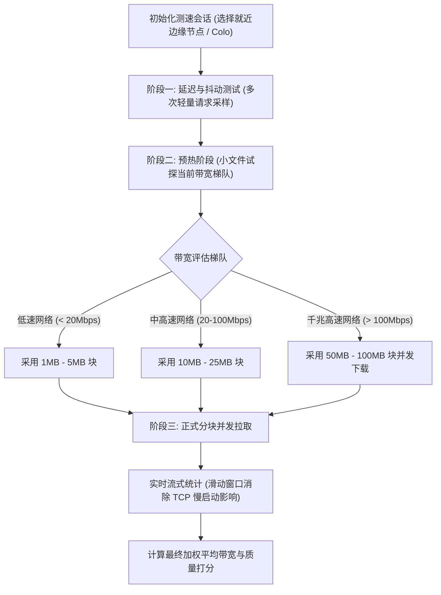

# 工具 04：网络测速引擎算法与实现

本教程详细解析 MyIP 中 **网络测速（Speed Test）** 的核心算法、网络评估模型与解耦实现。

---

## 1. 测速指标与数学模型

一个专业的网络测速工具绝不仅仅是“下载一个文件看耗时”，而是由**四大核心质量指标**共同构成的综合评价体系：

### 1.1 往返时延（Latency / RTT）
- **定义**：数据包从客户端发出，经过网络传输到达边缘节点并立即返回所经历的时间（毫秒 ms）。
- **测量方法**：通过向目标边缘服务器连续发起轻量探测包（如 `HEAD` 请求或极小静态资源），剔除最大与最小的异常抖动点后取均值或中位数。

### 1.2 延迟抖动（Jitter）
- **定义**：连续数据包到达时间差的变化幅度，反映了网络的**稳定性**。抖动越高，视频会议、实时语音和在线游戏越容易出现卡顿或掉帧。
- **数学模型 (RFC 3550)**：
  计算相邻两次延迟测量的绝对差值，采用一阶低通加权平均：
  $$J_i = J_{i-1} + \frac{|D(i-1, i)| - J_{i-1}}{16}$$
  （在轻量实现中，常用相邻样本延迟差值的绝对平均值 $\frac{1}{N-1}\sum_{i=1}^{N-1} |RTT_{i+1} - RTT_i|$）

### 1.3 下行带宽（Download Speed）
- **定义**：客户端从服务器拉取数据的实际吞吐速率（单位：Mbps 或 MB/s）。
- **计算公式**：
  $$\text{Throughput (Mbps)} = \frac{\text{接收数据字节数 (Bytes)} \times 8}{\text{有效传输耗时 (秒)} \times 10^6}$$

---

## 2. 现代 Web 测速引擎的设计挑战与对策



1. **规避 TCP 慢启动（Slow Start）干扰**：
   TCP 连接建立初期拥塞窗口较小，如果直接计算从 0 秒开始的均值，会严重拉低真实带宽。引擎通常会在传输开始 1~2 秒后才开启计量窗口，或使用分段分块下载。
2. **多线程/并发拉取突破单连接瓶颈**：
   单条 TCP 连接往往受限于单流拥塞控制或丢包退避，现代测速引擎（如 Cloudflare Speedtest）采用多连接（4~8 个并发 Stream）并发拉取，充分占满用户物理带宽。
3. **避免浏览器内存溢出**：
   对于动辄 100MB 的测速流量，前端不能将数据全部保存在内存或 Blob 中，而是通过流式读取（`ReadableStreamDefaultReader`）并在读取到 chunk 计数后立即丢弃。

---

## 3. 独立示例运行

本教程提供完全隔离的单文件 Node.js 测速脚本 [`demo.js`](./demo.js)：
- **完全解耦**：无需前端界面，纯命令行展示；
- **真实边缘探测**：直接连接全球 CDN 边缘测速端点（Cloudflare Speed Server）；
- **全流程覆盖**：
  1. 探测客户端连接的 CDN 边缘节点机房代码（Colo，如 SJC/HKG/NRT）与出口 IP；
  2. 连续 5 轮 RTT 延迟采样，计算出真实延迟与 RFC 抖动值；
  3. 执行分块下载，统计实时传输字节与下行吞吐量（Mbps）。

```bash
node tutorials/04-speed-test/demo.js
```
